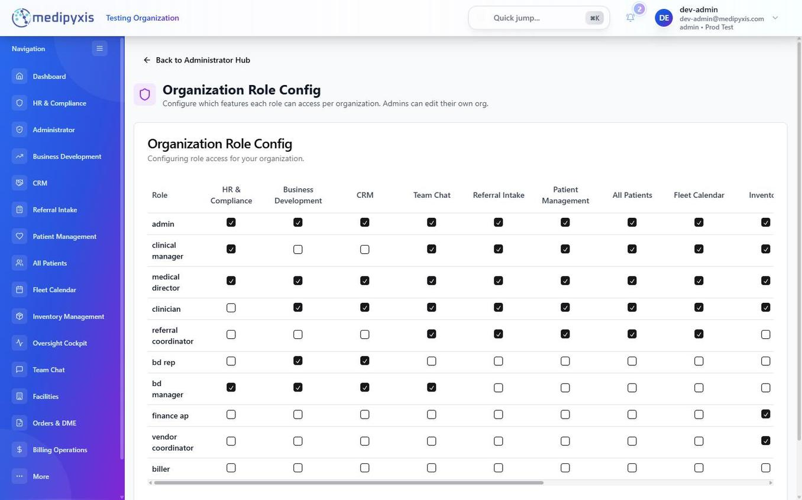

# Configure organization roles and permissions

The **Organization Role Config** screen is where you control which features each role can open across your Medipyxis organization.

---

## Before you start

- You need the **Admin**, **Clinical Manager** or **BD Manager** role at one or more facilities, or Medipyxis platform access.
- Settings are **per organization**. You pick the organization at the top of the screen.
- Changes reach a user the next time their page loads.

---

## Open the screen

Click **Administrator** in the sidebar, then the **Organization Role Config** tile.

**Note:** The **Administrator** hub is shown to the Admin role. Clinical Managers and BD Managers can use the screen but may not see the tile; send them the link /administrator/org-role-config.

*The* ***Organization Role Config*** *matrix. Rows are roles; columns are features. A ticked box means the role can open that feature.*

---

## Roles

Medipyxis has ten built-in roles. You cannot add your own, but you can change what each one can open.

| **Role** | **Typical job** |
| --- | --- |
| Admin | Runs the organization; manages facilities and users |
| Clinical manager | Oversees clinical staff and scheduling |
| Medical director | Clinical oversight and sign-off |
| Clinician | Documents visits and manages patients |
| Referral coordinator | Works Referral Intake and the fax queue |
| BD rep | Business Development and CRM |
| BD manager | Leads BD reps |
| Finance AP | Accounts payable |
| Vendor coordinator | Product catalog and inventory |
| Biller | Claims, payments and denials |

Roles used by Medipyxis staff sit above these and are not configured here.

---

## Features you can turn on or off

Each column in the matrix is a sidebar feature:

- HR & Compliance
- Administrator
- Business Development
- CRM
- Team Chat
- Referral Intake
- Patient Management
- All Patients
- Fleet Calendar
- Inventory
- Oversight Cockpit
- Facilities
- Orders & DME
- Billing Operations
- More

The Dashboard is not in the matrix; everyone has it. Always check the live checkboxes rather than assuming defaults, because your organization may already have changed them.

---

## Set a permission

1. Open **Organization Role Config** and pick the organization from **Select Organization**.
2. Find the role row and the feature column.
3. Tick or untick the box.
4. Click **Save Changes**.

**Warning:** Removing a feature from a role hides that sidebar link for everyone with the role on their next page load. Tell affected staff before you change it.

---

## Worked example

Scenario: let referral coordinators see **Fleet Calendar** so they can check availability.

1. Open Organization Role Config and pick the organization.
2. Find the referral coordinator row and tick **Fleet Calendar**.
3. Click **Save Changes**.
4. Tell referral coordinators the link will appear in their sidebar.
