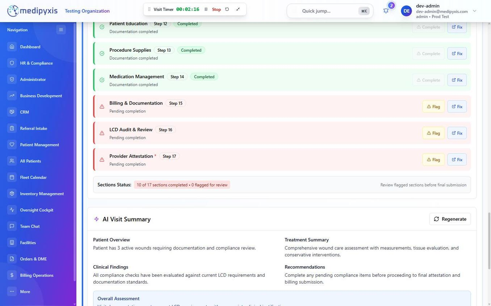
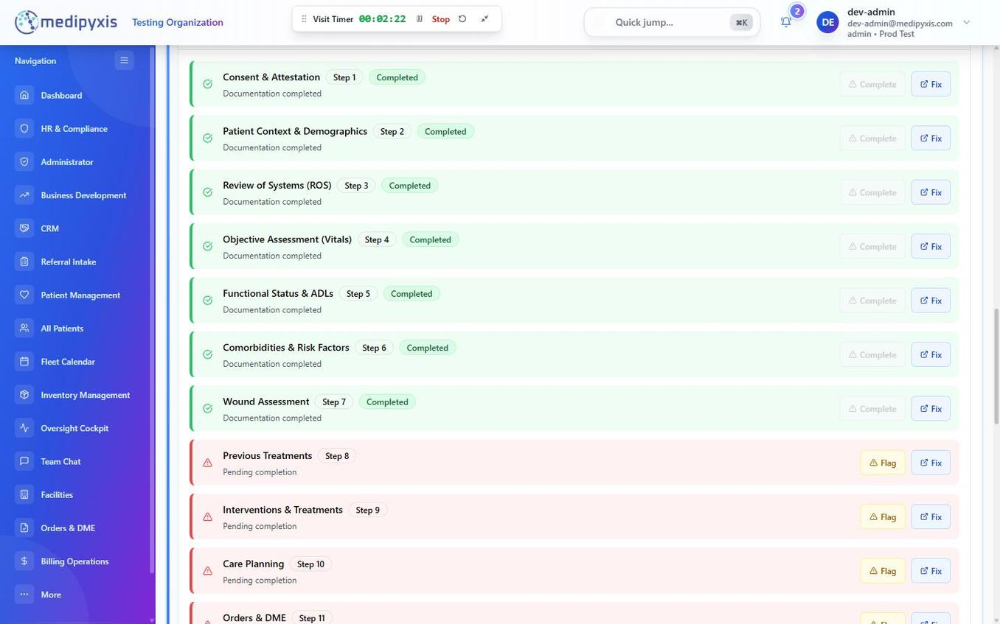

# Use the LCD compliance status and review

The Visit Wizard tracks Medicare Local Coverage Determination (LCD) compliance as you document. The **LCD Compliance Status** card at the top of the wizard shows how many of the 17 sections are complete and includes a compliance badge, and each section shows its own status so you can see what still needs attention before you sign.

**Important:** A green status means the documented sections satisfy the wizard's built-in checks. It does not guarantee Medicare reimbursement. Your biller and medical director are responsible for final compliance determinations.

---

## The LCD Compliance Status card

At the top of the wizard, the card shows:

- **Counts** — for example *10 Complete • 7 Pending*, plus *Flagged* when sections are marked for review.
- **A progress bar** with one segment per section: green when complete, yellow when flagged, pale red when pending. Hover over a segment to see the section's name and status.
- **The compliance badge** — a small chip that updates shortly after you change an entry. Green means all checks pass, amber means at least one item is flagged for review, and gray means the check is still running. Click the badge to open billing and compliance details for the visit.

*The LCD Compliance Status card and the wizard's section list.*

---

## Section status

Each of the 17 sections shows one of these statuses:

| **Status** | **What it means** | **What to do** |
| --- | --- | --- |
| **Completed** | The section is marked complete. | Move on. |
| **In Progress** | The section you have open. | Finish it, then click **Mark as Complete**. |
| **Needs Attention** | A recommended item in the section is missing or invalid. | Open the section and fill in the fields outlined in red. |
| **For Review** | The section is flagged for review. | Review the section before you sign. |
| **Pending** | The section hasn't been completed yet. | Open and complete the section. |

Missing items are reminders, not blocks: you can still save, continue, and sign.

---

## The 17 sections

| **#** | **Section** |
| --- | --- |
| 1 | Consent & Attestation |
| 2 | Patient Context & Demographics |
| 3 | Review of Systems (ROS) |
| 4 | Objective Assessment |
| 5 | Functional Status & ADLs |
| 6 | Comorbidities & Risk Factors |
| 7 | Wound Assessment |
| 8 | Previous Treatments |
| 9 | Interventions & Treatments |
| 10 | Care Planning |
| 11 | Orders & DME |
| 12 | Patient Education |
| 13 | Procedure Supplies |
| 14 | Current Medication |
| 15 | Billing & Documentation |
| 16 | LCD Audit & Review |
| 17 | Provider Attestation |

*The full section list with statuses.*

---

## Section 16 — LCD Audit & Review

Section 16 checks the visit against the Medicare coverage policy that applies. While it runs you see *Checking this visit against the coverage policy…*; click **Reload audit** to run it again after you change something.

- **Coverage policy** — the policy for the patient's Medicare contractor and the services on the visit. When no specific policy applies, it shows *General Medicare standard applies*.
- **Patient compliance** — patient-level findings, or *All clear*.
- **Audit readiness** — *Audit readiness: N open*. Expand it to see each open item, and click **Go to field** to jump to the field that needs it.
- **Per-wound findings** — documentation prompts for each wound, or *No findings for this wound*.
- **Wound Context** — the wound's documented assessment from section 7 (wound bed composition, drainage, surrounding skin, pain, and status) so you can check it in one place.

Findings are guidance. They never block a save or your signature.

---

## Resolve an open item

1. Find a section showing **Needs Attention** or **Pending**, or an open item under **Audit readiness** in section 16.
2. Open the section, or click **Go to field**.
3. Complete the missing entry. Your work saves as you go.
4. Click **Mark as Complete** on the section.
5. In section 16, click **Reload audit** to check again, then continue to section 17, **Provider Attestation**.

---

## Troubleshooting

| **Symptom** | **Likely cause** | **What to do** |
| --- | --- | --- |
| A section still shows **Needs Attention** | A recommended field is still empty or invalid | Open the section and complete the fields outlined in red. |
| The counts don't change after you finish a section | The section isn't marked complete | Click **Mark as Complete** on the section. |
| Section 16 still lists an item you fixed | The audit hasn't run again since your change | Click **Reload audit**. |
| The compliance badge stays gray | The check is still running, or couldn't run | Wait a moment. If it stays gray, use section 16 and click **Reload audit**. |
