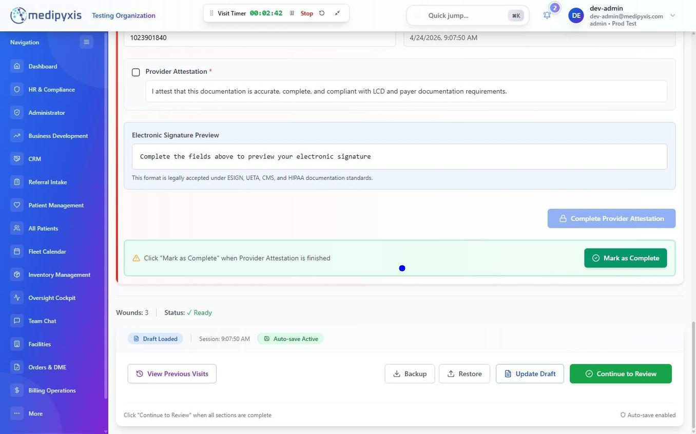

# Sign off on a visit with Provider Attestation (step 17)

Complete step 17 of the Visit Wizard by reading the attestation statement, confirming your details, and clicking Complete Provider Attestation. Then review the note and click Sign & Lock. Use an addendum for any corrections after signing.

## Before you start

- The earlier steps of the Visit Wizard are complete, including LCD Audit & Review (step 16).
- Step 17 is filled for the visit's clinician when they hold a valid 10-digit NPI. Otherwise the supervising provider chosen in Step 2 signs. When the wizard is opened in completion mode, Provider Attestation is view only.
- You have confirmed that all clinical documentation reflects the actual care provided during this encounter.

Under CMS documentation requirements, the rendering provider, not a scribe or co-signing clinician alone, must attest to the accuracy and completeness of the encounter note. Verify your organization's co-signature policy before delegating attestation.

## Steps

**Complete Provider Attestation**

1. **Open step 17.** Open the Provider Attestation section (badge Step 17) in the wizard. The fields are available as soon as the section opens.
2. **Read the attestation statement.** It reads: "I attest that this documentation is accurate, complete, and compliant with LCD and payer documentation requirements."
3. **Confirm your details and attest.** Confirm the provider name, Professional Title and 10-digit NPI, tick the Provider Attestation box, and click **Complete Provider Attestation**. Your electronic signature is the typed line "Electronically Signed By: name, credential, NPI, Date". There is no signature pad.

_The bottom of the Provider Attestation section. The Electronic Signature Preview shows the typed signature line. Continue to Review is in the bar at the bottom of the wizard._

The Electronic Signature Preview notes that this format is legally accepted under ESIGN, UETA, CMS, and HIPAA documentation standards.

**Review and Sign & Lock**

1. **Click Continue to Review** at the bottom of the wizard.
2. **Check the progress note preview**, then click **Looks Good, Continue**.
3. **Click Sign & Lock** in the review window. Sign & Lock becomes available once the review has loaded. Medipyxis locks the encounter note, records the date/time stamp and your user identity, and updates the appointment status on the **Fleet Calendar** to `Visit Completed`. A **Go to Billing** prompt appears so you can move the completed encounter into the billing workflow.

If the visit's service date does not match the appointment date, a Date check prompt appears at Sign & Lock. Switch to the appointment date, or keep your date and pick a reason.

---

## Result

The encounter note is locked and marked `Visit Completed`. The signed note is available in the patient's chart and, depending on your billing workflow, is queued for claim generation. The rendering provider's name, credential, NPI, date of service and signature timestamp print in the Provider Attestation block at the end of the note.

If your practice uses co-signature, the supervising clinician completes the optional Physician Sign-Off section. When the scheduler flagged the appointment, the section shows Co-sign Requested. It does not block Sign & Lock.

---

## Adding an addendum after signing

Once a note is signed, the encounter is read-only. To correct or add information, use an addendum.

1. **Open the signed visit.** On the "This visit is signed and locked" screen, click **Add an addendum**.
2. **Pick the Type of Addendum** (Correction, Clarification, Late entry, Fabrication remediation, or Other) and write the reason (at least 10 characters).
3. **For a sentence you did not write**, choose Fabrication remediation and tick the statements you are correcting, for example _Procedure tolerance was a template default_ or _LCD citation was wrong (cited policy does not govern this service)_.
4. **Enter the addendum text.** Describe what changed and why. Do not delete or re-state the original note. The addendum appears as a dated attachment below the original signed note.
5. **Click Submit Addendum.** The addendum is appended to the encounter record with your name, credential, and a new timestamp.

Pick the reason that names what you are correcting. A reviewer reads the reason alongside the addendum text, so a precise reason is worth more than a general one.

Addendum content is permanently appended to the encounter record. Do not use an addendum to alter the clinical meaning of a note after the fact without a legitimate clinical or administrative reason.

---

## Troubleshooting

- **Complete Provider Attestation is disabled.** It stays disabled until the provider name, Professional Title, a 10-digit NPI and the attestation tick are all present.
- **Provider Attestation shows "Provider authored · view only".** The wizard was opened in completion mode. Ask the rendering provider to open the visit and complete step 17.
- **The Fleet Calendar still shows the old status after signing.** Refresh the Fleet Calendar. Sign & Lock sets the appointment to Visit Completed.
- **There is no Add an addendum button.** The note is not signed yet. The "This visit is signed and locked" screen, with Add an addendum, appears only for a signed visit.
