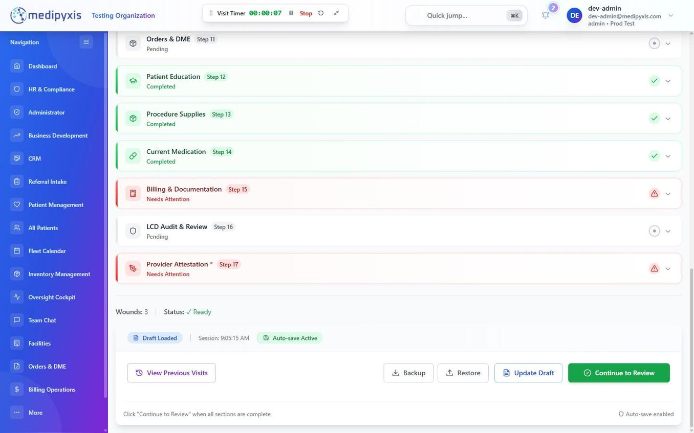

# Walk through a visit in the Visit Wizard

**To stop a visit you already started:** leave the Visit Wizard before Sign & Lock — the visit stays an unsigned draft. To remove a draft you will not finish, open the appointment card and archive the draft, then pick a reason (see [Stop or cancel a visit you started](#stop-a-visit)).

Open the Visit Wizard from the Fleet Calendar or the Wound Cockpit, then work through the numbered sections, Step 1 to Step 17, plus Step 2b (Clinical History Review) between Steps 2 and 3. This guide covers the full happy path plus the wizard's core behaviors: continuous autosave, pulling in prior data, clinical history carry-forward, the LCD ambient badge, warn-and-proceed validation, DoseSpot e-prescribing, Procedure Supplies, AI-assisted drafting, and **Sign & Lock**.

## Before you start

- Your appointment is on the **Fleet Calendar**, or you opened the patient's **Wound Cockpit**.
- Location services are not needed to document a visit. The visit timer and its GPS geofence are switched off in the Visit Wizard.
- For follow-up visits, review the Wound Cockpit "Where this wound is at" panel so you know what carries forward — see [Wound Cockpit](/modules/visit-wizard-ehr/wound-cockpit/).

---

## 1. Open the wizard

**From the Fleet Calendar**

1. **Navigate to Fleet Calendar.** Click **Fleet Calendar** in the sidebar. The calendar opens in Day view by default, with swim lanes per provider.
2. **Tap the appointment tile.** The Appointment Details window opens with the patient, date, and time.
3. **Click Start Visit.** It reads **Continue Visit** or **Resume Visit** when a note is already in progress. The Visit Wizard opens for that patient and appointment.

**From the Wound Cockpit**

1. From the patient chart, open the **Wound Cockpit**.
2. Pick the appointment in the visit picker and click **Open**, or choose **+ Start visit — pick a calendar slot…** to book one first.

The wizard opens with your saved work loaded and all sections collapsed. Open the section you want from the list; completed sections show a checkmark. The LCD ambient badge appears in the wizard header. The visit timer is switched off.

---

## 2. Pull in prior data

There is no Pull from History button. When you open a returning patient's visit, the wizard pre-fills the carry-forward sections from the most recent finalized visit automatically. For a transferred patient, a migration context banner also appears.

- **Pull Migration Data** — at the top of the wizard. For patients migrated from a prior EMR, it pulls the imported chart data into the visit.
- **Smart AI Import** — in the action buttons at the bottom of the wizard. It reads a PDF you upload and pre-fills wound fields. Saving is held until you resolve any import warnings.

Carry-forward is a starting point, not a substitute for re-assessment. Always review pulled values against the patient in front of you before signing.

---

## 3. Step 1 — Consent & Attestation

Step 1 shows the consent on file for this patient. If none is on file, use **Capture consent**, **Record signed paper**, or **Record verbal consent**. A missing consent is advisory: the visit can still be documented and signed.

---

## 4. Step 2 — Patient Context & Demographics

1. **Check the visit type.** The visit type comes from the appointment; Step 2 does not ask for it.
2. **Enter the Chief Complaint.** You can dictate it with Voice.
3. **Review insurance.** Coverage is shown here for reference. The **secondary payer is read-only**. Edit insurance on the patient's Billing & Auth page, not in the wizard.

**Step 2b — Clinical History Review.** Review allergies here, along with surgical, family and social history, current medications, problems and immunizations.

---

## 5. Steps 3–6 — Clinical baseline

- **Step 3 Review of Systems (ROS)** — body-system checklist. Pre-populated from the prior visit; review each system and update as needed.
- **Step 4 Objective Assessment** — vitals: BP, HR, Temp, SpO₂, Respirations, Weight, Height, BMI.
- **Step 5 Functional Status & ADLs** — ambulation and ADL independence.
- **Step 6 Comorbidities & Risk Factors** — diabetes, PAD, CVI, CHF, smoking status and other risk factors.

Your work saves automatically as you type, and the LCD ambient badge re-checks about a second after each change.

---

## 6. Step 7 — Wound Assessment

1. **Confirm wound etiology and staging.** Stage drives the ICD-10 selection downstream.
2. **Set the wound's Treating / Monitoring status.** A wound marked **Monitoring** carries a yellow pill and relaxes some required fields for that visit; flip it back to **Treating** at any time.
3. **Measure today.** Enter **Length (cm)**, **Width (cm)**, and **Depth (cm)**. Take or upload a wound photo. It is recommended for every wound you are treating (optional for Monitoring wounds) and does not block you from finishing.
4. **Set tissue percentages** (Granulation, Slough, Necrotic, Epithelial, Eschar). They should total 100%; the wizard flags a different total but does not block you.
5. **Confirm the anatomical location.** Specific Area is read-only here; click **Change** to pick a different site from the anatomical site picker.
6. Document exudate, pain, and infection signs.

See [Wound Assessment](/modules/visit-wizard-ehr/wound-assessment/) for the full reference.

---

## 7. Step 8 — Previous Treatments

Document prior interventions so the plan and LCD checklist have the history they need.

1. Add or update prior treatments — offloading, compression, debridement history, prior grafts.
2. Review the **Medical Necessity Statement**. Click **Summarize prior treatments** for a draft you must review.

Record the ankle-brachial index in Step 4 (Objective Assessment). If you add compression therapy in Step 9 with no ABI on file, the Done button stays disabled: "ABI is required before compression therapy can be ordered."

---

## 8. Step 9 — Interventions & Treatments

1. **Select debridement type** if performed: `sharp`, `mechanical`, `enzymatic`, or `autolytic`.
2. **Choose dressing(s)** from the catalog. Record ultrasonic therapy (MIST / Arobella) if used.
3. Click **Generate Procedure Note** for a procedure narrative; review and edit it.

---

## 9. Step 10 — Care Planning

1. Record the treatment goals, then set the **Follow-up Interval** and **Next Visit Date**.
2. **AI-assisted draft.** Click **Generate Draft** under the treatment plan to get an AI draft. Review it and choose **Accept**, **Edit before accepting**, or **Discard**.

After you sign in, Medipyxis asks you to acknowledge the current **AI Disclaimer** whenever you have not yet accepted its latest version.

---

## 10. Step 11 — Orders & DME

Add clinical orders and DME. **DME is a vendor-fulfilled order** — there is no product picker here; you order the item and it is fulfilled downstream.

---

## 11. Step 12 — Patient Education

1. Select patient education handouts.
2. Record Education Topics Covered Today and the Patient Understanding Assessment.

---

## 12. Step 13 — Procedure Supplies

1. Enter the Box UID/UIN, lot and quantities for grafts and supplies.
2. Enter wastage (units wasted), if any. It is optional.

Inventory is deducted and a **tissue log** entry is written when you press **Continue to Review**.

_The lower part of the section list. Continue to Review is in the bar at the bottom of the wizard._

---

## 13. Step 14 — Current Medication

Manage the patient's medications and prescribe through **DoseSpot**. Pharmacy selection and the prescription itself are handled in the DoseSpot window. See [Prescribe with DoseSpot](/modules/visit-wizard-ehr/medication-dosespot/).

---

## 14. Step 15 — Billing & Documentation

1. Click **Pull Codes** to fill billing codes from your documentation (a rule-based mapper; no AI). Review and edit every line.
2. Verify E/M level, modifiers (`25`, `59`, `KX`, `JW`, `JZ`), and **POS code**.

---

## 15. Step 16 — LCD Audit & Review

Step 16 shows the coverage-policy findings for the visit: a patient-level card and a findings row for each wound. Findings can link back to the section where the data must be entered. See [LCD Navigator](/modules/visit-wizard-ehr/lcd-navigator/).

---

## 16. Step 17 — Provider Attestation

1. Read the attestation sentence. The Electronic Signature Preview notes the ESIGN Act, UETA, CMS, and HIPAA standards.
2. Complete your name, credentials and NPI. The Electronic Signature Preview shows how your signature will read. Click **Complete Provider Attestation**.
3. Click **Continue to Review**, check the note preview, then click **Sign & Lock**. If the service date does not match the appointment date, a Date check prompt asks you to switch to the appointment date or keep your date and pick a reason.

Once locked, a **Go to Billing** prompt appears. The note is now locked and any later change requires an **Addendum** with a documented reason. The note PDF is filed in the background. See [Sign Off](/modules/visit-wizard-ehr/sign-off/).

---

## Saving and resuming

- **Continuous autosave** — each field is saved as you complete it, so drafts survive network drops and device switches. The web wizard is online-only; there is no separate offline mode.
- **Resume** by opening the same appointment from the Fleet Calendar (the button reads Continue Visit) or from the Wound Cockpit picker. Your saved work loads on any device; open the section you were on.

---

## Result

You completed all 17 sections, the Medical Necessity Statement and billing codes are reviewed, and the rendering provider has attested and pressed **Sign & Lock**. The encounter is locked, the note is filed, and a **Go to Billing** prompt hands the encounter off to billing.

---

## Stop or cancel a visit you started

If you leave the Visit Wizard before Sign & Lock, the visit stays an unsigned draft.

To remove a draft you will not finish, open the appointment card and archive the draft. Pick a reason: _Duplicate of another draft_, _Wrong patient_, _Abandoned / not going to finish_, or _Other_. If the patient was not seen, mark the appointment not seen and pick a reason, such as _Patient unavailable_ or _Patient refused_.

---

## Troubleshooting

- **The wizard shows the wrong patient.** You tapped the wrong appointment tile. Close the wizard, then reopen it from the correct tile.
- **The Done button in the compression dialog is disabled.** No ABI is on file. Enter the ABI in Step 4 or in the Compression Therapy card in Step 9.
- **The LCD ambient badge stays amber.** One or more checks still need data. Click the badge to re-run the check, and use the step 16 findings to jump back to the section.
- **"Signed and locked — note still filing" appears after Sign & Lock.** The visit is locked and the note is still being filed. If the note does not appear in Progress Notes, contact support.
