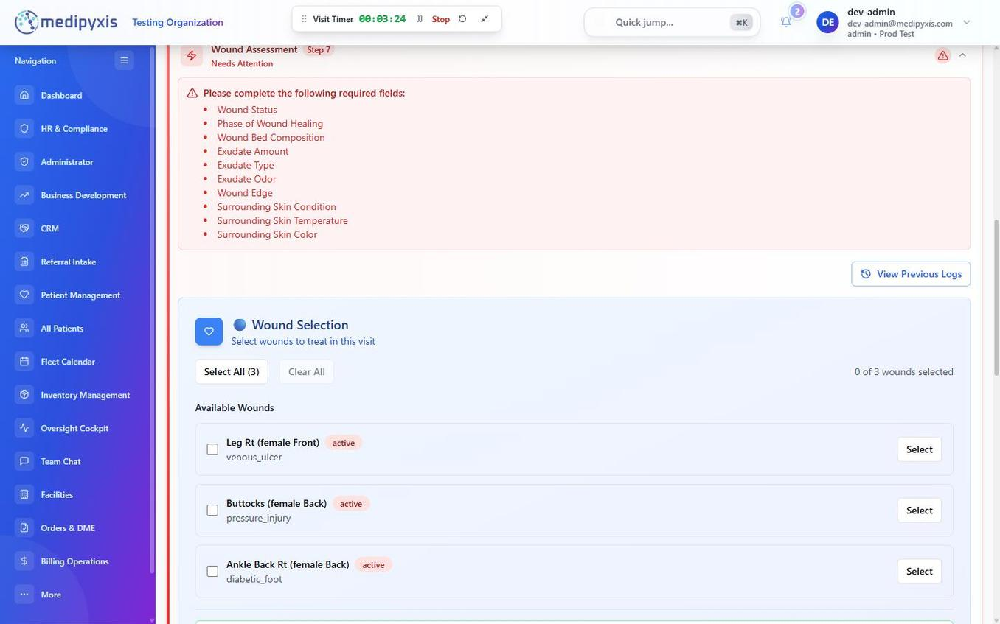
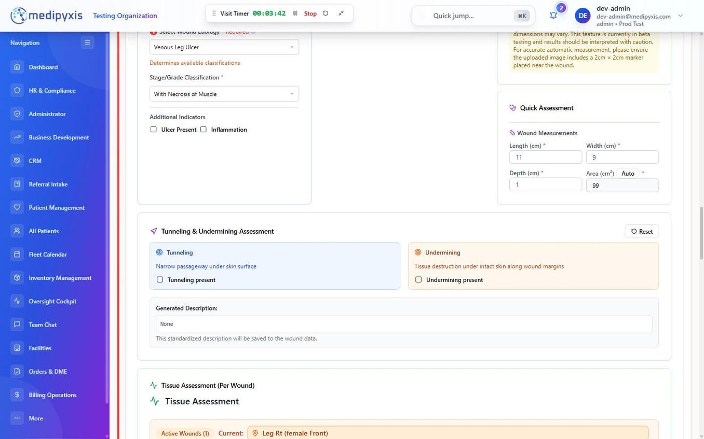
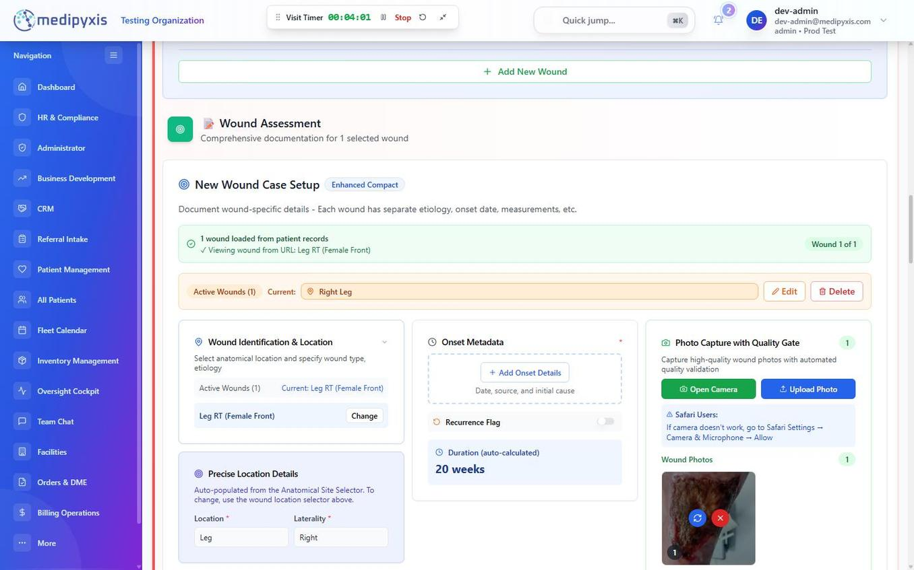
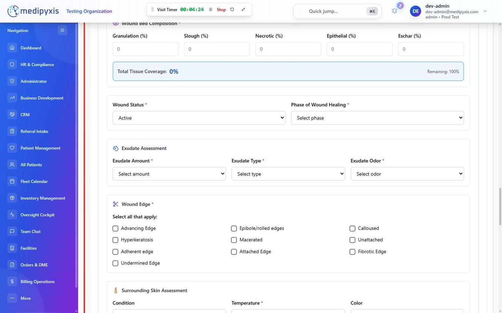
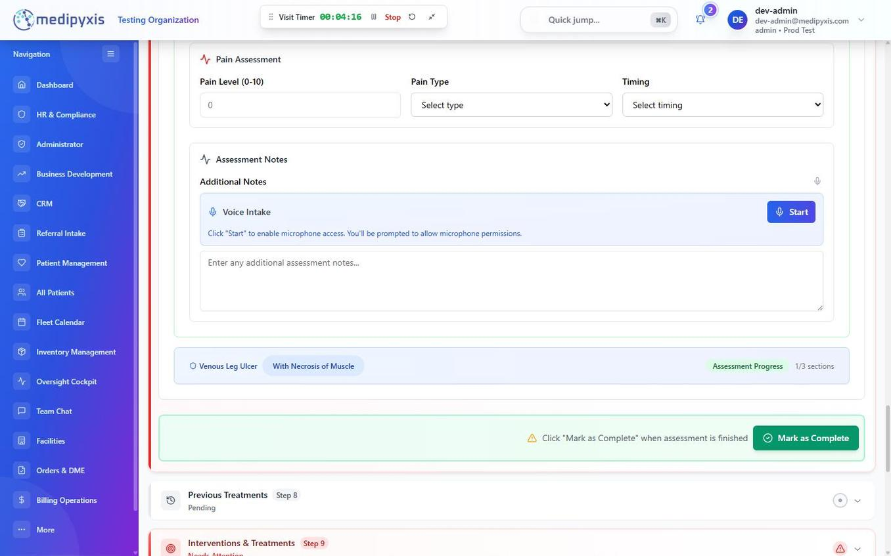
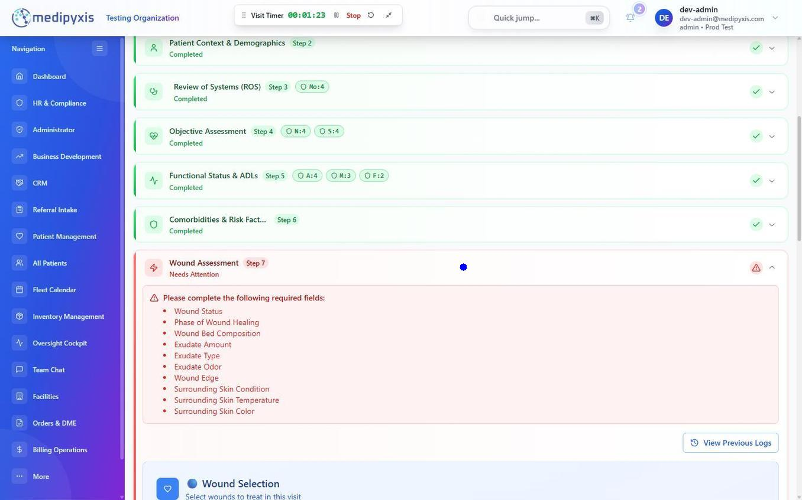

# Complete the Wound Assessment (section 7)

Document every wound you assess in section 7 of the Visit Wizard: location, classification, measurements, tissue, drainage, wound edge, surrounding skin, pain, infection status, and photos — the details Medicare coverage policies look for and that track healing from visit to visit.

The ankle-brachial index (ABI) is entered in section 4, **Objective Assessment**, not here. If you add compression therapy in section 9 (**Interventions & Treatments**) with no ABI on file, the compression window asks for one: *ABI is required before compression therapy can be ordered.* You can enter it there. See [Visit Wizard overview](/modules/visit-wizard-ehr/overview/).

---

## Before you start

- You have opened the visit in the Visit Wizard. Sections 1–6 come before it.
- You have a ruler or measuring guide for length, width, and depth.
- You have a device with a camera for wound photos.

---

## Steps

### 1. Open Wound Assessment

Open **Wound Assessment** (Step 7) in the section list.

### 2. Choose or add the wound

- On a follow-up visit, if the patient has wounds from earlier visits, a **Seen this wound before?** panel lists them. Pick the wound you are documenting and Medipyxis brings its last visit forward, so its healing stays on one chart.
- For a wound not seen before, click **Add New Wound** (**Add First Wound** when the visit has no wounds yet).

Each wound has a **Treating** / **Monitoring** status. Set a wound to **Monitoring** when you are watching it rather than actively treating it. It shows a yellow pill, relaxes some recommended fields for the visit (a photo is optional, for example), and stays Monitoring on the next visit until you switch it back to **Treating**.

### 3. Identify and locate the wound

| **Field** | **Details** |
| --- | --- |
| **Location** and **Specific Area** | The body site, then the precise area on it |
| **Laterality** | Left · Right · Bilateral · Midline · Not Applicable |
| **Onset Details** | **Onset Date** (required), source, and initial cause |

### 4. Classify the wound

Choose the etiology in **Select Wound Etiology**. The etiology decides which classifications appear next.

- Pressure Injury
- Diabetic Foot Ulcer
- Venous Leg Ulcer
- Arterial Ulcer
- Mixed Arterial-Venous
- Surgical Wound
- Atypical Wound
- Malignant Wound
- Fungating Wound
- Trauma Wound
- Moisture-Associated Skin Damage (MASD)
- Infection / Cellulitis / Abscess

Then choose the **Stage/Grade Classification**. For a pressure injury the choices are Stage 1 to Stage 4, Unstageable, Deep Tissue Injury, and Unspecified Stage. For ulcers such as diabetic foot, venous, and arterial ulcers, the choices describe depth — for example *Limited to Breakdown of Skin*, *With Fat Layer Exposed*, or *With Necrosis of Bone*. A diabetic foot ulcer also gets a Wagner grade (0–5) in the infection section — see step 10.

### 5. Measure the wound

| **Field** | **Notes** |
| --- | --- |
| **Length (cm)** | Greatest dimension |
| **Width (cm)** | Perpendicular to length |
| **Depth (cm)** | Deepest point |
| **Area (cm²)** | Marked *Auto*: calculated as length × width once both are entered. You can overwrite it. |

If tunneling or undermining is present, record it under **Tunneling & Undermining Assessment**: depth in centimeters and the clock positions it runs between.

### 6. Take or upload photos

Under **Wound Photos**, click **Open Camera** or **Upload Photo**. A photo is recommended for every wound you are treating; for a Monitoring wound it is optional. Many Medicare coverage policies expect photo documentation at each visit for skin substitute (graft) coverage, so follow your facility's protocol and take the photo before you leave the patient.

Photos are compressed automatically before they are saved. If a photo is still too large, you see *This photo is too large to save*: try a different photo, or open the photo shrinker to compress it further.

### 7. Record wound bed composition

Under **Wound Bed Composition**, enter the percentage of each tissue type: granulation, slough, necrotic, epithelial, and eschar. Together they should total 100%.

**Total Tissue Coverage** shows the running total: green at exactly 100%, blue below 100%, and red above it. The wizard does not let the total go past 100% — it caps the value you are typing and tells you the most you can enter.

### 8. Record drainage

| **Field** | **Options** |
| --- | --- |
| **Exudate Amount** | None · Scant · Light · Moderate · Heavy |
| **Exudate Type** | None · Serous · Sanguineous · Serosanguineous · Purulent |
| **Exudate Odor** | No · Yes |

### 9. Assess the wound edge, surrounding skin, and pain

- **Wound Edge** — tick every description that applies, for example *Attached Edge*, *Unattached*, *Epibole/rolled edges*, *Advancing Edge*, *Fibrotic Edge*, *Undermined Edge*, *Calloused*, or *Macerated*.
- **Surrounding Skin Assessment** — **Condition** (Intact, Macerated, Erythematous, Indurated, Excoriated, Hyperpigmented, Hyperkeratosis), plus temperature and color.
- **Pain Level (0-10)** — tap a number from 0 (no pain) to 10 (worst pain), then choose the pain type and timing.

### 10. Record infection status

Answer **Infection present** (Yes or No). If yes, tick the signs you see. They are grouped as local signs of wound infection, signs of spreading infection, and systemic signs of infection.

For a diabetic foot ulcer, also choose the **Wagner grade** (Grade 0–5). At Wagner grade 3 or higher, the wizard also asks for the **IWGDF/IDSA diabetic foot infection grade** (Uninfected, Mild, Moderate, or Severe).

### 11. Repeat for each wound and finish

Your entries save as you go. Use the wound picker to move between wounds, and repeat steps 2–10 for each one. When every wound is documented, click **Mark as Complete** and continue to section 8, **Previous Treatments**.

---

## Missing items

If a recommended item is missing, the field is outlined in red and the section lists it under *Recommended for complete documentation — you can still finish this visit.* These are reminders: they don't stop you saving or moving on.

---

## Result

Each wound has an assessment with its location, classification, measurements, tissue composition, drainage, pain, infection status, and photos. The **LCD Compliance Status** card at the top of the wizard includes a compliance badge that updates shortly after you change an entry: green when its checks pass, amber when something is flagged for review. See [Use the LCD compliance status and review](/modules/visit-wizard-ehr/lcd-navigator/).

---

## Troubleshooting

| **Symptom** | **Likely cause** | **What to do** |
| --- | --- | --- |
| Total Tissue Coverage is not 100% | The five tissue percentages do not add up to 100 | Adjust the values until the total shows 100% in green. |
| A field is outlined in red | A recommended item is missing | Fill it in, or continue — it does not block you. |
| *This photo is too large to save* | The photo is still too large after automatic compression | Try a different photo, or open the photo shrinker. |
| **Area (cm²)** is not filling in | Length or width is empty | Enter both **Length (cm)** and **Width (cm)**. |
| The compression window says an ABI is required | No ABI is on file for this visit | Enter the ABI in the compression window or in section 4, **Objective Assessment**. |
