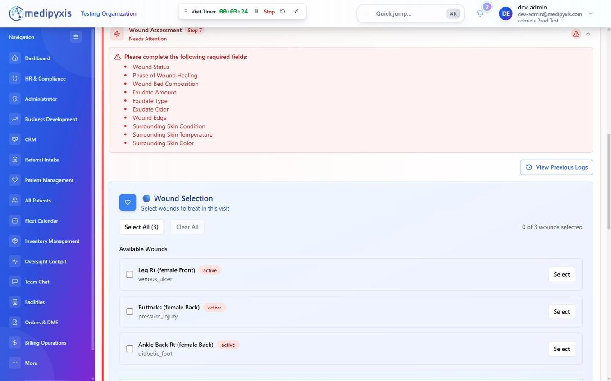
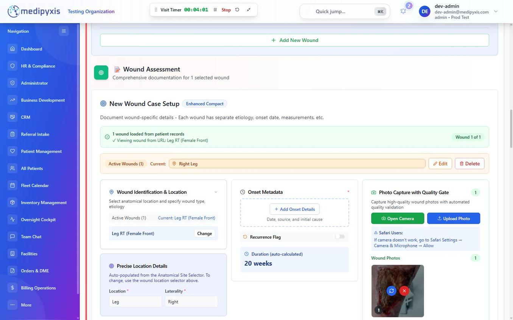
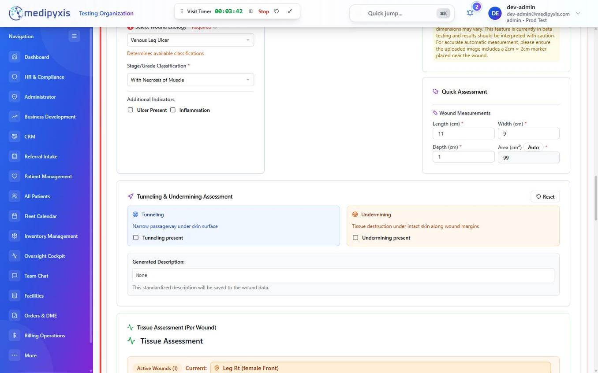
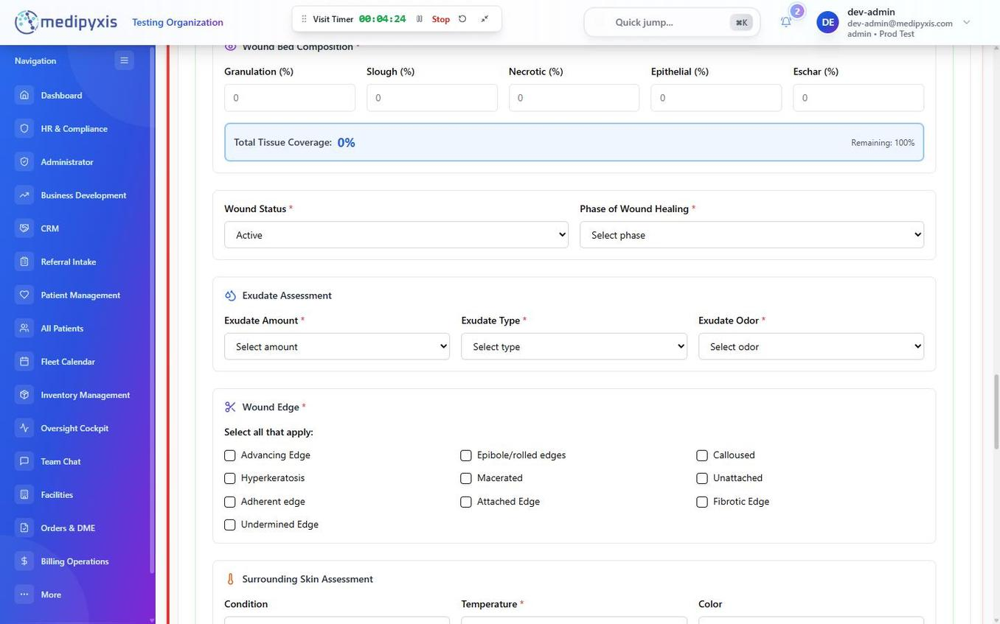

# Complete the Wound Assessment (section 7)

Document all active wounds in step 7 (Wound Assessment) of the Visit Wizard, capturing anatomy, measurements, **tissue percentages by wound**, **precise anatomical location**, exudate, pain, and photos needed for Medicare LCD compliance and longitudinal wound tracking.

ABI is recorded in step 4 (Objective Assessment, perfusion). If it is missing when you add compression, you can enter it in the Compression Therapy card in step 9. If no ABI is on file, the Done button in the Compression Therapy dialog stays disabled with the message "ABI is required before compression therapy can be ordered." Enter the ABI to continue.

## Before you start

- You have a ruler or wound measurement tool available for length, width, and depth.
- A camera-enabled device is ready if photo upload is required by your facility protocol.

## Steps

**Open Wound Assessment**

1. **Open step 7.** Click **Wound Assessment** in the step list. Steps do not have to be completed in order. The step you have open shows In Progress.

_Step 7 opens with Wound Selection: the patient's wounds carried forward from the chart._

2. **Select the wound or add a new one.** Select the wounds to treat in this visit, or click **Add New Wound** to document a new one.

Each wound carries a **Treating / Monitoring** status. Set a wound to **Monitoring** when you are watching it rather than actively treating it. It shows a yellow marker and relaxes some required fields for the visit. The choice is saved with the wound.

**Complete the wound assessment form**

3. **Check identification and location.**

- **Wound switcher** — with more than one wound, it shows which wound you are on (for example, 1 of 3).
- **Anatomic Location** — a precise anatomic site (for example, Right lateral malleolus), editable per wound.
- **Laterality** — Left, Right, Bilateral, Midline, or Not Applicable.
- **Onset Date** — entered with a date picker (**Add Onset Details**).
- **Duration** — calculated from the onset date. It cannot be edited directly; change the onset date to change it.

_The wound case setup: location, onset details with the calculated duration, and photo capture._

4. **Select Wound Etiology.** Choose Pressure Injury, Diabetic Foot Ulcer, Venous Leg Ulcer, Arterial Ulcer, Mixed Arterial-Venous, Surgical Wound, Atypical Wound, Malignant Wound, Fungating Wound, Trauma Wound, Moisture-Associated Skin Damage (MASD), or Infection / Cellulitis / Abscess.
5. **Select Stage/Grade Classification.** The options depend on the etiology. Diabetic foot ulcers are graded on the Wagner scale (Wagner 0–5). For a Pressure Injury, choose Stage 1 to Stage 4, Unstageable, Deep Tissue Injury, or Unspecified Stage.

_Etiology and classification, wound measurements with the automatic area, and tunneling and undermining._

6. **Enter measurements.** Length (cm), Width (cm) and Depth (cm). Area cm² is calculated automatically as Length × Width. Record **Tunneling** depth and direction, and **Undermining** by o'clock position and depth, if present.
7. **Document tissue composition.** Enter Granulation, Slough, Necrotic, Epithelial and Eschar percentages. The five fields are checked against a total of exactly 100%. The Total Tissue Coverage indicator is red above 100%, green at exactly 100%, and blue below 100% with the remaining percentage shown.

_Wound Bed Composition with the Total Tissue Coverage indicator, then wound status, exudate and wound edge._

8. **Select Exudate Amount and Type.** Exudate Amount: None, Scant, Light, Moderate, or Heavy. Exudate Type options include Serous, Serosanguineous, Sanguineous, and Purulent.
9. **Record Exudate Odor** as Yes or No.
10. **Select the surrounding skin condition:** Intact, Macerated, Erythematous, Indurated, Excoriated, Hyperpigmented, or Hyperkeratosis.
11. **Select Wound Edge.** Tick all that apply. The options include Attached Edge and Epibole/rolled edges.
12. **Rate Pain.** Rate Pain Level (0-10) by tapping a number.
13. **Complete the Infection Signs checklist.** Check all that apply from the infection indicators list (erythema, warmth, swelling, purulent drainage, malodor, increased pain, fever, lymphangitis, cellulitis). Leave unchecked if absent.
14. **Add a photo.** Click **Open Camera** to take a photo, or **Upload Photo** to pick one from the device.
15. **Finish the step.** Your entries save automatically. If you document more than one wound, use the wound switcher at the top of the form to move between wounds. When every wound is documented, click **Mark as Complete** at the bottom of step 7.

Many Medicare LCDs require photographic documentation at each visit for advanced biological therapy (graft) coverage. Confirm your facility's protocol and upload the photo before leaving the patient's location.

---

## Validation

If something is missing, the wizard lists it as recommended for complete documentation. You can still finish the visit. If tissue percentages do not total 100 or a field is missing, **Mark as Complete** still closes the step, with a warning listing what is recommended for complete documentation.

---

## Result

Each wound has a saved assessment record with measurements, tissue composition, exudate, pain score, infection status, and photos. As you type, the [LCD badge](/modules/visit-wizard-ehr/lcd-navigator/) in the wizard header re-checks the visit and shows All clear (green) or a flag count (amber).

## Troubleshooting

- **Area cm² is not updating.** Length or Width is empty. Enter both **Length (cm)** and **Width (cm)**.
- **Photo upload fails.** The photo is very large (over 75 MB) or cannot be read. Retake it with the camera button or try a smaller photo.
